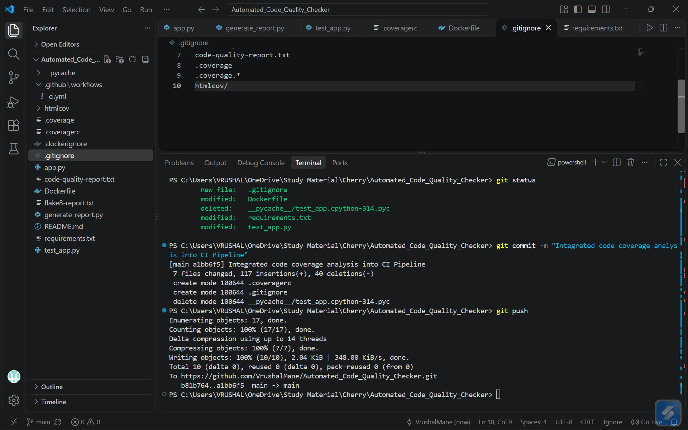
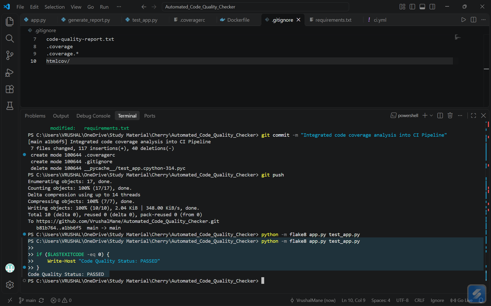
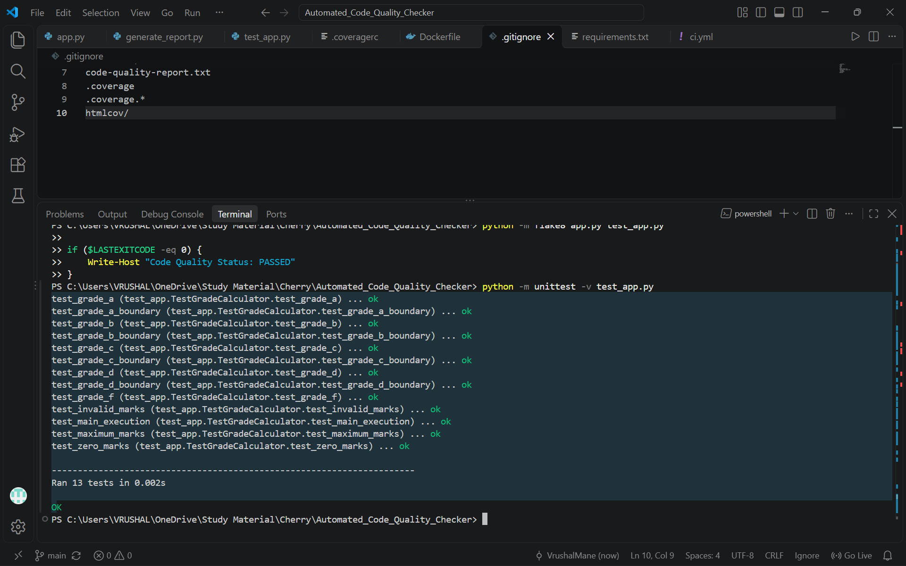
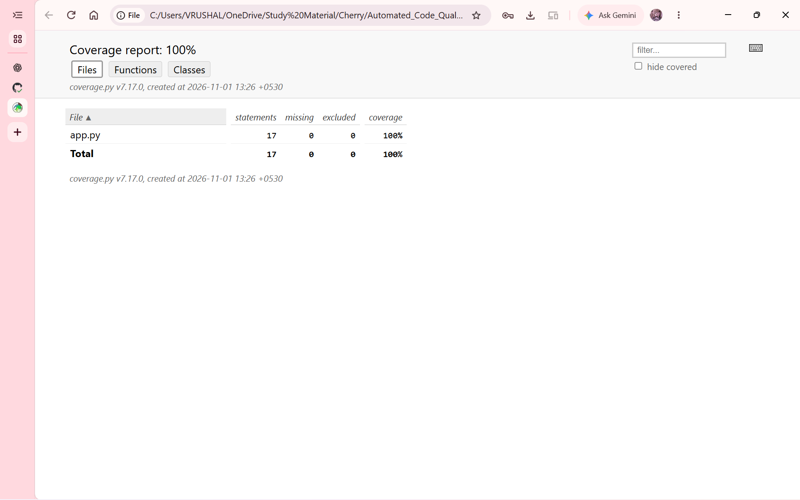
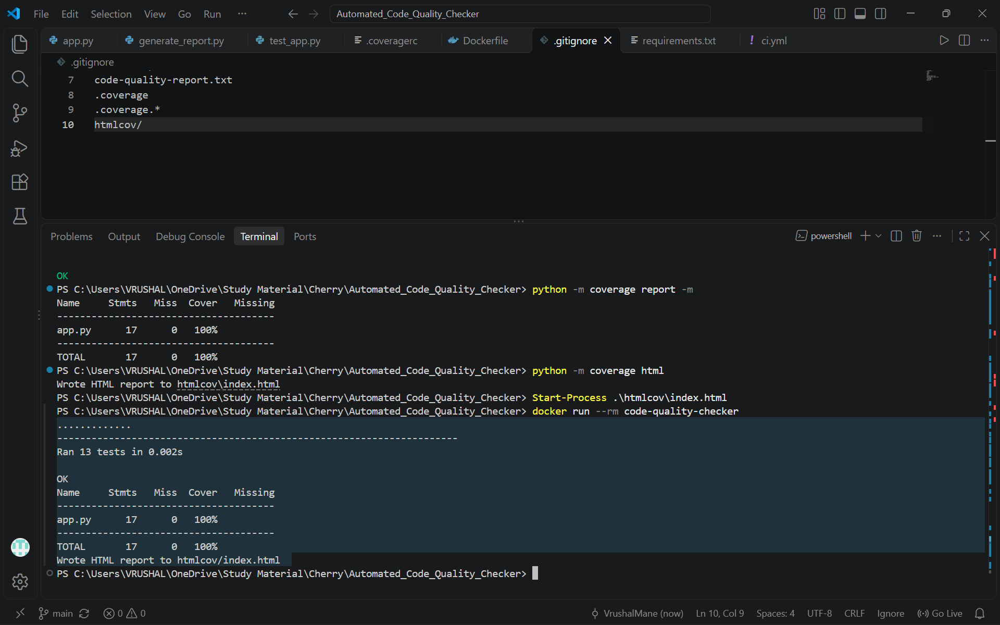
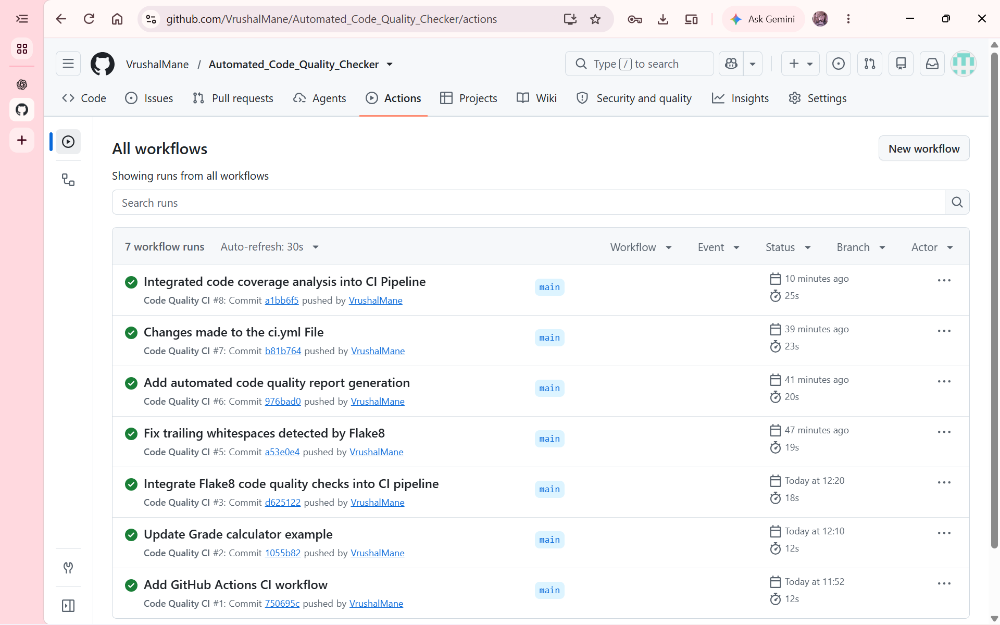
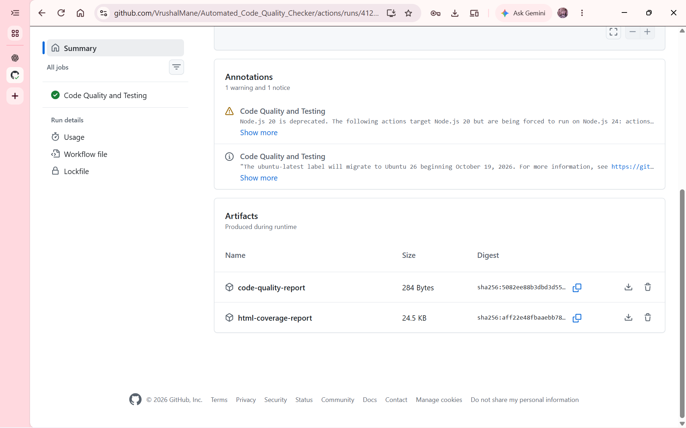

# Automated Code Quality Checker

An automated Python code quality and testing project that uses **Flake8, Unit Testing, Code Coverage, Docker, and GitHub Actions** to maintain code quality and automate the software testing process.

## 📌 Project Overview

The Automated Code Quality Checker is a Python-based DevOps project designed to automate code quality analysis and software testing.

The project uses a Student Marks Validator application as its sample Python application. It automatically checks the source code for coding standard violations, executes unit tests, measures code coverage, and runs the application testing process inside a Docker container.

GitHub Actions integrates these processes into a Continuous Integration (CI) pipeline that executes automatically whenever code is pushed to the main branch or a pull request is created.

## 🎯 Project Objectives

- Automate Python code quality checking.
- Detect coding standard violations using Flake8.
- Execute automated unit tests.
- Measure code coverage.
- Run testing inside a Docker container.
- Implement a Continuous Integration pipeline using GitHub Actions.
- Generate and upload code quality and coverage reports.

## ✨ Key Features

- **Automated Code Quality Analysis:** Uses Flake8 to identify coding standard violations.
- **Unit Testing:** Executes automated test cases using Python's unittest framework.
- **Code Coverage Analysis:** Measures how much of the application code is tested.
- **HTML Coverage Report:** Generates a visual report of code coverage.
- **Docker Integration:** Runs the testing process inside a Docker container.
- **Continuous Integration:** Automatically executes the quality-checking pipeline using GitHub Actions.
- **Automated Report Generation:** Generates code quality and coverage reports.
- **Artifact Upload:** Stores generated reports as downloadable GitHub Actions artifacts.

## 🛠️ Technologies Used

| Technology | Purpose |
|---|---|
| Python | Application development |
| Flake8 | Code quality checking |
| unittest | Automated unit testing |
| Coverage.py | Code coverage analysis |
| Docker | Containerization |
| GitHub Actions | CI automation |
| Git & GitHub | Version control and repository hosting |

## 📂 Project Structure

```text
Automated_Code_Quality_Checker/
│
├── .github/
│   └── workflows/
│       └── ci.yml
│
├── screenshots/
│   ├── 01-project-structure.png
│   ├── 02-flake8-check.png
│   ├── 03-unit-tests.png
│   ├── 04-coverage-report.png
│   ├── 05-docker-execution.png
│   ├── 06-github-actions-success.png
│   └── 07-github-artifacts.png
│
├── app.py
├── test_app.py
├── generate_report.py
├── requirements.txt
├── Dockerfile
├── .dockerignore
├── .gitignore
├── .coveragerc
└── README.md
```

## ⚙️ Application Description

The project uses a Student Marks Validator application to demonstrate automated code quality checking and testing.

The application accepts student marks and returns a grade according to predefined conditions.

| Marks | Grade |
|---|---|
| 90–100 | A |
| 75–89 | B |
| 60–74 | C |
| 40–59 | D |
| 0–39 | F |
| Outside 0–100 | Invalid Marks |

## 🚀 Installation and Setup

### 1. Clone the Repository

```bash
git clone https://github.com/VrushalMane/Automated_Code_Quality_Checker.git
```

### 2. Navigate to the Project Directory

```bash
cd Automated_Code_Quality_Checker
```

### 3. Create a Virtual Environment (Optional)

```bash
python -m venv .venv
```

Activate it on Windows PowerShell:

```powershell
.\.venv\Scripts\Activate.ps1
```

### 4. Install Dependencies

```bash
pip install -r requirements.txt
```

## ▶️ Running the Application

Execute the Python application:

```bash
python app.py
```

Expected output:

```text
B
F
Invalid Marks
C
```

## 🔍 Code Quality Checking

The project uses Flake8 to check Python files for coding standard violations.

Run:

```bash
python -m flake8 app.py test_app.py
```

If no violations are found, the command completes without displaying errors.

Generate the code quality report:

```bash
python generate_report.py
```

The report displays the number of files checked, total violations, and overall code quality status.

## 🧪 Automated Unit Testing

The project uses Python's unittest framework to execute automated test cases.

Run:

```bash
python -m unittest -v test_app.py
```

The test suite contains **13 test cases**, covering:

- Grade A, B, C, D, and F.
- Grade boundary conditions.
- Zero marks.
- Maximum marks.
- Invalid marks.
- Main program execution.

## 📊 Code Coverage Analysis

Coverage.py is used to measure the percentage of application code executed during testing.

Run the following commands:

```bash
python -m coverage run -m unittest test_app.py
```

Display the coverage summary:

```bash
python -m coverage report -m
```

Generate the HTML coverage report:

```bash
python -m coverage html
```

Open the generated report:

```bash
Start-Process .\htmlcov\index.html
```

**Current Test Result:**

| Metric | Result |
|---|---:|
| Total Statements | 17 |
| Missing Statements | 0 |
| Code Coverage | 100% |
| Unit Tests | 13 Passed |

## 🐳 Docker Integration

Docker is used to execute the application testing and code coverage process inside a container.

### Build Docker Image

```bash
docker build -t code-quality-checker .
```

### Run Docker Container

```bash
docker run --rm code-quality-checker
```

The container automatically performs:

1. Dependency installation during image building.
2. Flake8 code quality checking.
3. Automated unit testing.
4. Code coverage analysis.
5. HTML coverage report generation.

## 🔄 GitHub Actions – Continuous Integration

The project implements a Continuous Integration pipeline using GitHub Actions.

The workflow is triggered automatically when code is pushed to the `main` branch or when a pull request targets the `main` branch.

### CI Pipeline Workflow

1. Checkout the GitHub repository.
2. Set up the Python environment.
3. Install project dependencies.
4. Generate the code quality report.
5. Execute Flake8 code quality checking.
6. Run automated unit tests with coverage.
7. Display the coverage summary.
8. Generate the HTML coverage report.
9. Build the Docker image.
10. Execute tests inside the Docker container.
11. Upload the code quality report.
12. Upload the HTML coverage report.

### Generated GitHub Actions Artifacts

The workflow uploads two artifacts:

- `code-quality-report` – Contains the generated code quality report.
- `html-coverage-report` – Contains the HTML code coverage report.

These artifacts can be downloaded from the corresponding successful GitHub Actions workflow run.

## 📸 Project Screenshots

### 1. Project Structure



### 2. Flake8 Code Quality Check



### 3. Automated Unit Testing



### 4. Code Coverage Report



### 5. Docker Execution



### 6. GitHub Actions Workflow



### 7. GitHub Actions Artifacts



## 📈 Project Results

The project successfully demonstrates an automated code quality and testing workflow.

- All 13 unit tests pass successfully.
- Flake8 reports no code quality violations.
- The application achieves 100% code coverage.
- Docker successfully executes the testing process.
- GitHub Actions successfully runs the CI pipeline.
- Code quality and HTML coverage reports are uploaded as workflow artifacts.

## 🎓 Learning Outcomes

Through this project, I gained practical experience with:

- Python application development and automated testing.
- Static code analysis using Flake8.
- Code coverage measurement.
- Docker image creation and container execution.
- Git and GitHub version control.
- GitHub Actions workflow configuration.
- Continuous Integration (CI) concepts.
- Automated report generation and artifact management.

## 🔮 Future Enhancements

- Integrate additional static code analysis tools.
- Add code security scanning.
- Introduce Continuous Deployment (CD).
- Add support for multiple Python applications.
- Generate detailed code quality dashboards.

## 👨‍💻 Author

**Vrushal Mane**

GitHub: [@VrushalMane](https://github.com/VrushalMane)

## 🔗 Project Repository

[Automated Code Quality Checker – GitHub](https://github.com/VrushalMane/Automated_Code_Quality_Checker)

---

⭐ If you find this project useful, consider giving the repository a star!